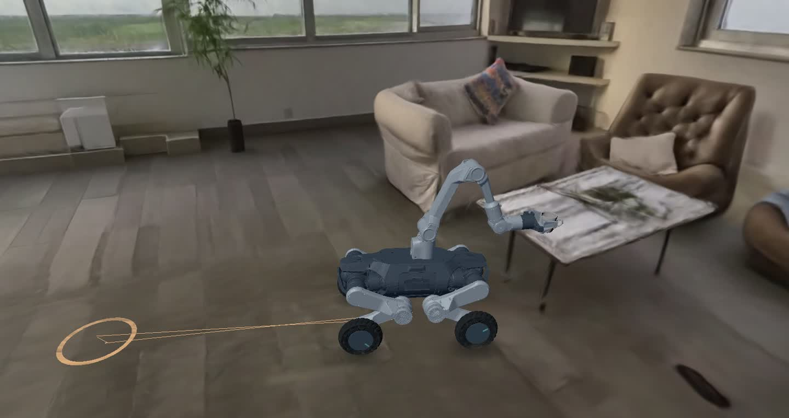

# Robot Gym · 把一张照片带进机器人仿真

**Robot Gym 是一个把真实照片变成机器人任务环境的仿真平台。** 上传客厅照片，用群核科技 Aholo World 生成空间；再上传杯子照片，用 Lux3D 生成物品。标定地面、尺度和茶几之后，就可以让模拟的云深处 S10 搭配 Piper 机械臂去取杯，并检查它在哪里接触、是否端稳、失败发生在哪一步。

[观看或下载 3 分 30 秒演示](https://github.com/wangyazheww/robot-gym/raw/refs/heads/main/demo-video/Robot-Gym-v3.mp4) · [中文字幕](demo-video/Robot-Gym-v3.srt) · [项目报告 PDF](output/pdf/Robot-Gym-参赛项目报告书-v3.pdf)



## 先看哪一段

| 时间 | 画面 | 可以核对的材料 |
| --- | --- | --- |
| 00:00–01:11 | 从照片到客厅，在三维视图里标定地面、行走区、碰撞盒与支撑面 | [S2 场景配置](backend/data/scenes_v1/s2_livingroom.json) |
| 01:11–02:20 | 选择杯壁材质，观看靠近、夹取、抬升和同步双指力 | [杯子模型与来源](backend/data/assets/mug_ceramic) · [桌面抓取采样](runs/upright_demo_nov19/run.json) |
| 02:20–03:30 | 打开一次失败记录，判断下一轮该改握力还是抓取姿态 | [30 次实验明细](runs/f6_v5/summary.csv) · [偏心摆放失败样例](runs/f6_v5/eccentric_feedback_s100/run.json) |

## 平台怎样工作

| 环节 | 实现和入口 |
| --- | --- |
| 照片生成空间和物品 | [Aholo 客户端](backend/app/aholo_client.py) 负责照片上传、World 单图生成或多图重建、Lux3D 任务提交与下载。[资产处理](backend/app/asset_pipeline.py) 将模型尺寸、碰撞几何与元数据交给工作台。 |
| 把房间变成任务空间 | [房间工作台](room.html) 加载高斯场景。[标定与材质工具](room-tools.js) 设置空间尺度、行走区、支撑面与摩擦预设。[后端](backend/app/main.py) 保存场景并调度仿真。 |
| 运行机器人任务 | [场景构建](gym/scene_v1.py) 将同一份标定转成 MuJoCo 接触几何。[客厅搬运](gym/room_carry.py) 执行到桌边、取杯和返回。[触觉观测](gym/observe.py) 提供接触力与滑动估计。研究员可以固定场景和种子，替换抓取策略。 |
| 回放与评测 | [客厅回放](evidence/room/s2-carry.json) 保存机器人与杯子的姿态。[批量评测](gym/batch.py) 和 [试次记录](runs/f6_v5) 用来比较不同策略，并保留失败样本。 |

### 杯壁材质如何进入实验

工作台将主要接触面的材料映射为滑动摩擦预设。金属为 0.35，玻璃或陶瓷为 0.40，橡胶为 0.95。实验者可以单独改变杯壁摩擦，控制器依据双指接触力、接触点数和滑动估计决定是否收紧。以上数值为仿真设定，实际杯壁和指垫的摩擦仍需测量。

## 本地运行房间工作台

使用 Python 3.12 和 Git。以下命令适用于 macOS 或 Linux，在本仓库根目录执行。首次安装和加载浏览器三维组件需要联网。预置客厅回放无需云服务密钥。机器人模型从云深处官方仓库的固定版本读取。

```bash
python3.12 -m venv .venv
source .venv/bin/activate
pip install -r backend/requirements.txt -r requirements-sim.txt
git clone https://github.com/DeepRoboticsLab/s10-piper-sdk.git spikes/s10-sdk2
git -C spikes/s10-sdk2 checkout 7f90b2ea7b052263351ca3457bd01bde1409f4a2
python scripts/prepare_robot.py
export ROBOTGYM_SIM_PYTHON="$PWD/.venv/bin/python"
python -m uvicorn backend.app.main:app --port 8000
```

打开 [本地房间工作台](http://localhost:8000/demo/room.html)，点「播放取杯演示」看预计算回放。要重新计算，进入「物品」，载入 S2 样例，再点「运行搬运」。若需生成自己的房间或物品，在启动前设置环境变量 `AHOLO_MOCK=0` 和自己的 `AHOLO_API_KEY`。视觉识别与规划器的可选配置见 [后端配置](backend/app/config.py)。

在同一虚拟环境中，以下命令将复跑输出写入新的目录：

```bash
python -m gym.room_carry --scene-id s2_livingroom --demo-bundle runs/local/s2-carry.json
python -m gym.record_upright --out runs/local/upright
```

## 实验结果与边界

S2 客厅携杯返回的起点误差为 **1.63 cm**。独立桌面特写的 359 个采样点中，最大杯口倾角为 **0.96°**，保持阶段最小离桌高度为 **10.83 cm**。底盘使用伺服辅助，双指确认接触后启用固定辅助。

历史批次对固定力度和触觉反馈各跑 15 次。两种策略在正常摆放、低摩擦、偏心摆放条件下分别完成 4/5、4/5、2/5 次。偏心样例在 0.75 秒结束，峰值指力为 0 N。这个失败发生在抓取姿态求解阶段，提示下一轮先改接近方向。新版杯口朝上特写是单独复跑。多图演示的 20 张输入来自同一张全景，独立实拍多视角样例的云端重建曾失败。

## 开源与素材

项目原创代码采用 [MIT 许可证](LICENSE)。生成的场景、照片、模型、比赛报告与演示媒体单独用于展示项目成果。机器人型号和 SDK 来自 [云深处科技](https://github.com/DeepRoboticsLab/s10-piper-sdk)，模型按上游条款获取；在线生成需要使用者自己的群核服务权限。
